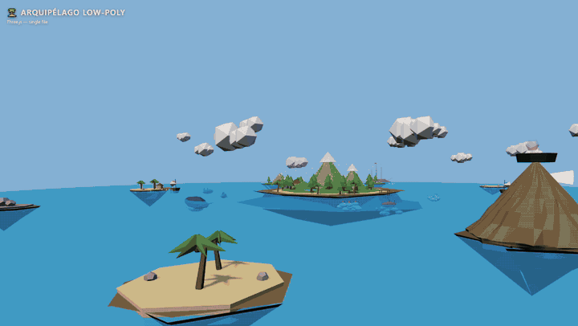
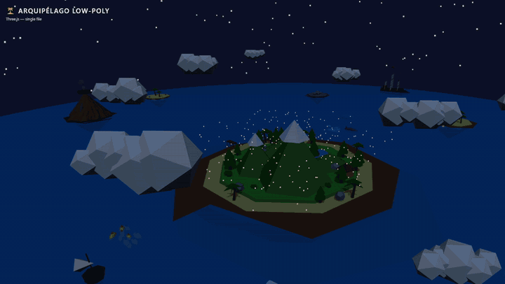

# 🏝️ Arquipélago Low-Poly

> **Um oceano 3D interativo nascido de código — gerado inteiramente com IA local, em um único arquivo HTML.**

Explore um arquipélago vivo com barcos navegando entre portos, tubarões patrulhando, uma baleia gigante, um vulcão ativo, ilhas geradas proceduralmente e nuvens interativas. Tudo rodando no navegador, em um único arquivo HTML.

**Clique** nas nuvens para nevar. **Toque** no vulcão para erupcionar. **Arraste** os barcos e solte — eles voltam à rota sozinhos.






---

## ▶️ Como Jogar/Explorar

### Rápido (30 segundos)
```bash
# Abra o arquivo island.html diretamente no navegador
# Ou, para uma experiência melhor (sem restrição CORS):
npx serve .  # ou qualquer servidor estático
```

Pronto! Abra no navegador. Não precisa instalar nada — o Three.js carrega via CDN.

### Executar local

```bash
# Opção 1: abrir direto
open island.html    # Mac
start island.html   # Windows
xdg-open island.html # Linux

# Opção 2: servidor local (recomendado)
python3 -m http.server 8000
# ou
npx serve -p 8000
```

Acesse em `http://localhost:8000`.

### No celular
Coloque o arquivo island.html no mesmo Wi-Fi e acesse pelo navegador.

---

## 🌍 O Que Tem no Mundo

| Elemento | Detalhe |
|---|---|
| 🏝️ **Ilhas** | Geradas proceduralmente com terreno, praias, montanhas e vegetação |
| ⛵ **Barcos** | 3 barcos navegando entre portos A→B→C; arraste-os e solte! |
| 🦈 **Tubarões** | 3 tubarões patrulhando o oceano |
| 🐋 **Baleia** | Uma baleia gigante navegando lentamente |
| 🌋 **Vulcão** | Toque para disparar uma erupção com partículas |
| ☁️ **Nuvens** | Toque para ativar neve! |
| 🚢 **Embarcação** | Grande navio mercante cruzando o horizonte |
| 🌊 **Ondas** | Simulação de ondas no oceano com movimento orgânico |
| 🎥 **Câmera** | OrbitControls — arraste para girar, scroll para zoom |

### Interações
- **Arrastar** → girar a câmera
- **Segurar num barco** → arrastar (soltar = ele volta à rota)
- **Toque numa nuvem** → nevar!
- **Toque no vulcão** → erupção com lava e fumaça
- **Scroll / 2 dedos** → zoom in/out
- **Touch 1 dedo** → rotacionar (celular)
- **Touch 2 dedos** → zoom (celular)

---

## 🏗️ Stack Técnica

| Tech | Uso |
|---|---|
| **Three.js** (r160) | Motor 3D via CDN (import map) |
| **OrbitControls** | Câmera orbital com damping |
| **Vanilla JS (ES Module)** | Tudo em um arquivo, sem bundler |
| **RNG com seed** | Geração determinística do arquipélago |
| **Procedural generation** | Terras, vegetação, barcos, criaturas |

### Features técnicas
- **PCFSoft shadow maps** — sombras suaves
- **ACES Filmic tone mapping** — cores cinematográficas
- **Fog (nieblina)** — profundidade e atmosfera
- **Touch events** — funcional em celular
- **Pixel ratio limitado** — performance em qualquer dispositivo
- **Geração procedural** — o arquipélago nasce sempre igual (seed fixa)
- **Single-file** — tudo em um `html` de ~60KB

---

## 🤖 Desenvolvido com IA Local

Este projeto nasceu da curiosidade de provar que é possível gerar mundos 3D interativos com ferramentas gratuitas e locais.

### O pipeline
```
Eu descrevia em linguagem natural
       ↓
pi harness orquestrava a geração
       ↓
Qwen 2.5 3B Q3-XXS gerava o código
       ↓
Eu revisava, ajustava, iterávamos
       ↓
Arquivo final rodando no navegador
```

### Configuração de Hardware
| Componente | Especificação |
|---|---|
| **CPU** | Intel i7-3770K @ 3.5GHz |
| **GPU** | NVIDIA RTX 2060 (12GB VRAM) |
| **RAM** | 16GB DDR3 |

### O modelo
```
Modelo:       Qwen-2.5 3B Q3-XXS (quantização extrema)
Quantização:  Q3-XXS — o formato mais comprimido do Qwen 2.5 3B
Loader:       Ollama
VRAM strategy: Camadas distribuídas GPU + CPU com overlap
```

### O que esse projeto prova?
- Um **único arquivo HTML** pode conter um mundo 3D completo e interativo
- Modelos LLM quantizados de ~3B são capazes de gerar código 3D **funcional e polido**
- Desenvolvimento com IA local: **custo zero, privacidade total, sem limites**
- Procedural generation + IA = mundos gerados sob demanda, sempre infinitos

---

## 📊 Performance

- **Desktop:** 60 FPS (câmera suave, sombras com shadow maps)
- **Celular:** 30+ FPS (pixel ratio limitado a 2x, geometria otimizada)
- **Tamanho total:** ~61 KB (tudo em um arquivo)
- **Dependências:** zero (Three.js via CDN)

---

## 🔧 Personalizar

Edite no `island.html`:

```js
// Alterar a seed gera um arquipélago diferente
let seed = 12345;  // ← mude aqui!

// Ajustar densidade de barcos
const NUM_BOATS = 3;  // ← mais ou menos barcos

// Configurar tamanho do vulcão
const volcanoHeight = 25;  // ← altura do vulcão
```

---

## 📜 Licença

Software livre. Estude, fork, adapte e compartilhe.

---

## 🙌 Créditos

Criado por Ambrosio (https://github.com/Ambrosios13) com assistência do modelo **Qwen 3.8 27B Q3-XXS** via Ollama + pi harness.

---

*"Um mundo inteiro, um arquivo, zero dependências. Feito com IA que roda na sua máquina."*